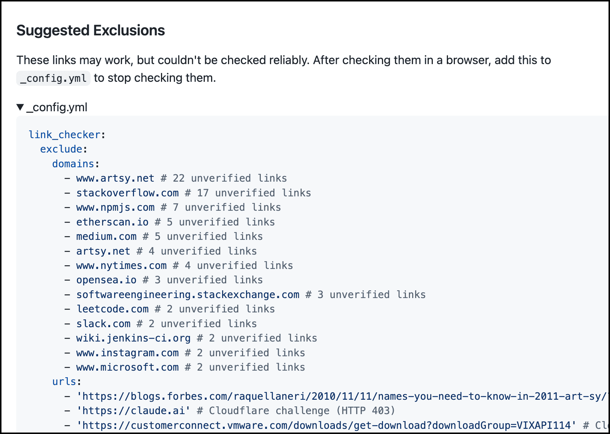

# Fixing Links

This guide explains what to do with each kind of link in a link checker report. Each link in the report shows a reason, such as `HTTP 404` or `Cloudflare challenge (HTTP 403)`, and the pages that link to it.

## Dead Links

Dead links fail the build, so fix or remove them.

### Page Not Found and Anchor Not Found

These are links to your own site. Either the link has a typo, or you renamed or removed the page or the heading it points to. Fix the link, or, if the page moved, add the old path to the page's `redirect_from` with [jekyll-redirect-from](https://github.com/jekyll/jekyll-redirect-from), so that links from other sites keep working too. For a missing anchor, link to the heading's new `id`, which you can find by inspecting the page in a browser.

### Not Found or Gone

The site answered HTTP 404 or 410: the page is gone. Search the site for where it moved, and update the link. If it's gone for good, link to an archived copy instead: search for the URL on the [Wayback Machine](https://web.archive.org), pick a capture from around the time you wrote the post, and link to it, for example `https://web.archive.org/web/2011/https://example.com/page`. If no copy exists, remove the link and keep the text.

### HTTP 500 and Up, Timeout, and Connection Error

The site didn't answer properly. That's often temporary, so check the link in a browser and wait for the next run. If it keeps failing for a week or more, treat it as a 404. A connection error on every run usually means the domain is gone.

### Invalid URL

The link is malformed, often because of a typo, a space, or a character such as `|` that must be escaped. Fix it in the page.

## Unverified Links

Many sites block automated requests, even though the page exists. The checker reports those links as unverified, and they don't fail the build. The reason says how the site blocked the request: a Cloudflare challenge, HTTP 401 or 403 (access refused), HTTP 429 (too many requests), or HTTP 999 (LinkedIn).

Open a few of them in a browser. If they work, there's nothing to fix. To stop checking them on every run, set `cache.blocked_ttl`, for example to `7d`. If a site answers with 429, the checker sent it too many requests at once: set `host_concurrency` and `host_interval` to slow down. If a site never lets the checker through, add it to `exclude.domains`, knowing that its links won't be checked at all.

If a link doesn't work in a browser either, it's dead: fix it as above.

## Links That Moved Permanently

With `permanent_redirects: true`, the report lists links that work but redirect permanently, with where they moved. Update each link to the new URL. Many are from `http` to `https`, or from an old domain to a new one, so a search and replace across your posts often fixes them all at once.

## Excluding Links

Some links can't be checked, such as links that need you to sign in, or searches that sites only answer for people. Exclude them in `_config.yml` rather than removing them. The report suggests the exclusions to add, under Suggested Exclusions, for the unverified links and the links to sites that didn't answer properly; check those links in a browser first. In `_config.yml`, `exclude.urls` takes exact URLs and regular expressions between slashes, `exclude.domains` takes sites, and `exclude.paths` takes regular expressions. See [Configuration](configuration.md).

