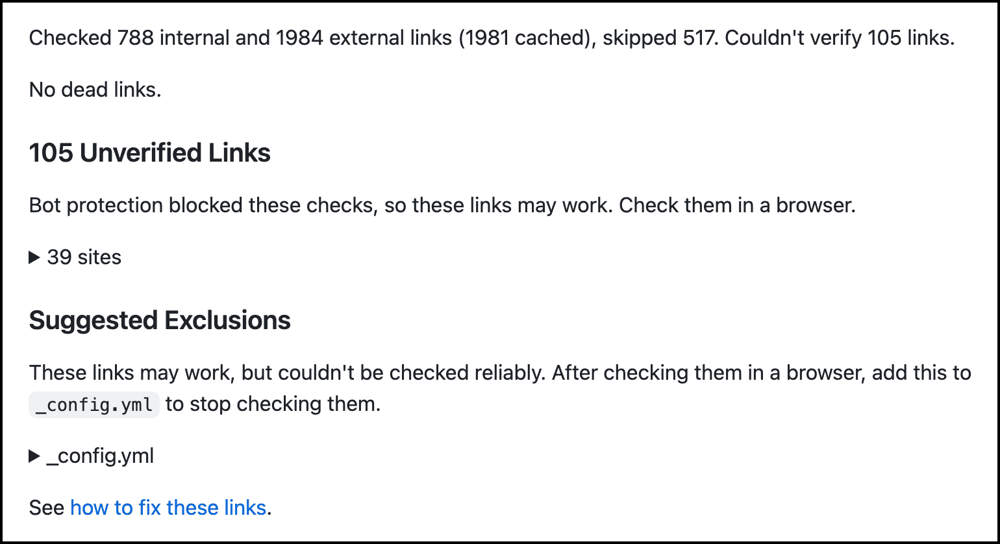
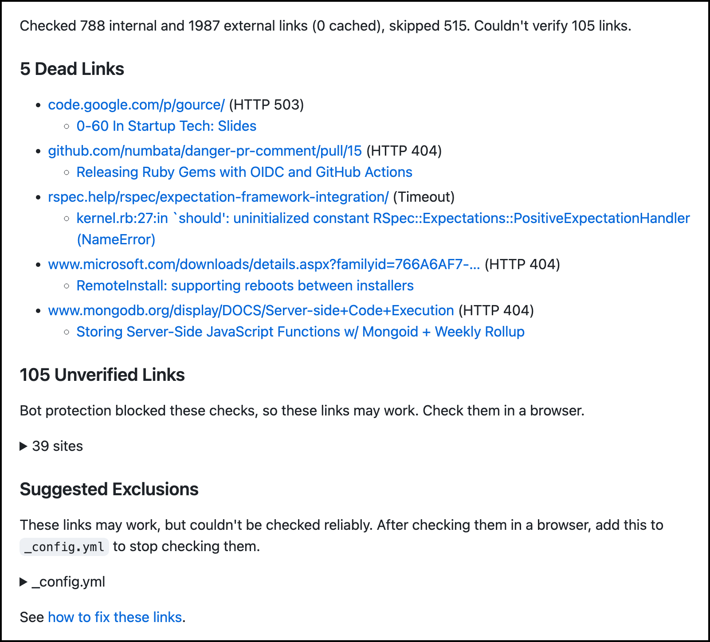

# GitHub Actions

Two reusable workflows check links in GitHub Actions. One checks links and only needs to read your repository, so it's safe to run on pull requests from forks. The other runs after it to comment on pull requests and keep an issue up to date.

## Checking Links

[`check-links.yml`](../.github/workflows/check-links.yml) builds your site with link checking on. It keeps the cache between runs, so each run only checks links that it hasn't checked recently. Every run adds a report to its summary and attaches it to the run.

For example, the job summary of a run on [code.dblock.org](https://code.dblock.org), where most links came from the cache:



```yaml
# .github/workflows/check-links.yml
name: Check Links

on:
  push:
    branches: [main]
  pull_request:
  schedule:
    - cron: '30 11 * * 0,3' # GitHub deletes caches that aren't used for a week
  workflow_dispatch:

permissions:
  contents: read

jobs:
  check-links:
    uses: dblock/jekyll-ruby-link-checker/.github/workflows/check-links.yml@v0.1.0
    with:
      ruby-version: '3.4'                           # default: read .ruby-version
      working-directory: .                          # where the site is (default: .)
      setup-command: sudo apt-get install -y libvips # runs before installing gems (default: none)
      build-command: bundle exec jekyll build       # (default: bundle exec jekyll build)
      cache-file: .cache/link-checker.json          # relative to the site (default: .cache/link-checker.json)
      cache-key-prefix: link-checker-               # (default: link-checker-)
      report-artifact: link-checker-report          # name of the report, or 'false' (default: link-checker-report)
      changed-files-only: true                      # pull requests only check the pages they change (default: true)
      fail-on-dead-links: ${{ github.event_name != 'pull_request' }} # (default: true)
      runs-on: ubuntu-latest                        # a runner label, or a JSON list (default: ubuntu-latest)
```

Pull requests only check the pages they change, so a pull request that adds a post checks that post. A pull request that changes a layout, `_config.yml`, the `Gemfile`, or anything else that affects every page, or that deletes or renames a file, checks every page. Pushes and scheduled runs always check every page.

The `fail-on-dead-links` example above fails on dead links everywhere except pull requests, which is useful while the site still has dead links of its own.

Inputs of reusable workflows must match their type, so quote `'false'` for `report-artifact`, which takes a name.

## Using the Action

The check is also an action, listed on GitHub Marketplace, which you can add as a step to a job of your own, for example to build your site in a matrix or run more steps after it. It takes the same inputs as `check-links.yml`, except `runs-on`, and runs the same steps. Check out with `fetch-depth: 2`, so that pull requests can only check the pages they change.

```yaml
# .github/workflows/check-links.yml
name: Check Links

on:
  push:
    branches: [main]
  pull_request:

permissions:
  contents: read

jobs:
  check-links:
    runs-on: ubuntu-latest
    steps:
      - uses: actions/checkout@v7
        with:
          fetch-depth: 2
      - uses: dblock/jekyll-ruby-link-checker@v0.1.0
        with:
          fail-on-dead-links: ${{ github.event_name != 'pull_request' }}
```

The action takes text inputs, so `fail-on-dead-links` and `changed-files-only` are `'true'` or `'false'`, or an expression. `publish-report.yml` publishes the report of a workflow named Check Links, so keep that name, as above, to use it.

## Publishing Results

[`publish-report.yml`](../.github/workflows/publish-report.yml) reads the report of a completed check. On a pull request, it comments with the dead links and keeps that comment up to date. On your default branch, it can keep an issue up to date: it opens the issue when there are dead links, updates it, and closes it when they're fixed. It never runs the code it checked, so it can safely comment on pull requests from forks.

The comment, and the issue, show the report, here from a run of code.dblock.org with five dead links, each under the posts that link to it:



```yaml
# .github/workflows/publish-link-checker-report.yml
name: Publish Link Checker Report

on:
  workflow_run:
    workflows: [Check Links]
    types: [completed]

permissions:
  actions: read
  issues: write
  pull-requests: write

jobs:
  publish:
    uses: dblock/jekyll-ruby-link-checker/.github/workflows/publish-report.yml@v0.1.0
    with:
      issue: 'true'          # 'true' for an issue titled Broken Links, a title, a number such as '123', or 'false' (default: 'false')
      comment: true          # comment on pull requests (default: true)
      runs-on: ubuntu-latest # (default: ubuntu-latest)
```

Quote `'true'`, `'false'`, and issue numbers, because `issue` takes text.
